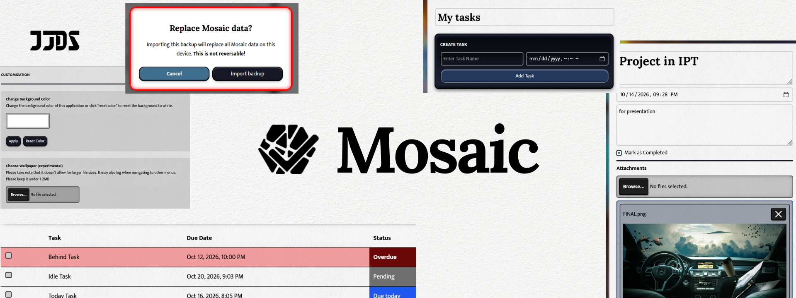

#Mosaic
Made by Joshua Singson

Category: 
Productivity, Task Management

Project Description:
Mosaic is a **to-do list web application** that utilises **LocalStorage and IndexedDB** to store configuration, task and attachment data. It's made to store user task in-device with personalisation capabilities. 

Features:
- Add, remove or modify tasks
- See Task Status based on date collected
- Live per-minute task updates (for updating tasks status from due today -> overdue)
- Add, remove or modify To Do Lists per tabs above the task sections
- Add, remove or preview attachments / files
- Change background color
- Add wallpaper + wallpaper blur
- Import and export user data for portability and safe keeping

Technologies Used:
- Localhost and indexedDB
- JSON
- JavaScript
- HTML and CSS
- Google Fonts API

Access it here:
https://anythingbutausername.github.io/mosaic/settings.html

---- More details below! ----

It has 5 modules:
- Settings.js handles wallpaper and background color customisation. 
- Tabs.js handle tab creation and removal.
- ToDo.js handle todo list and it's data
- Port.js handle both import and export functions.
- Load.js handle specific task loading, modification, saving and attachment CRUD.

2 HTML Files:
- Index.html contains to-do lists, tabs, and task CRUD functionalities
- Settings.html contains settings organised per category and methods.

1 CSS File:
- style.css offers near-skeuomorphic styling for the site

2 other files:
- Documentation provides screenshots of sections and pages
- Assets store my very own designed logos and icons

The code provided offers a more complete (yet imperfect) description of how methods work. 

Although originally made for my Integrative Programming final project, this is also a part of my greater long-term initiative to implement technology solutions alongside my passions, which includes UI design (albeit imperfect). Because of that, expect this project to further evolve in the future. 

Version: 0.1

Thanks for reading!
